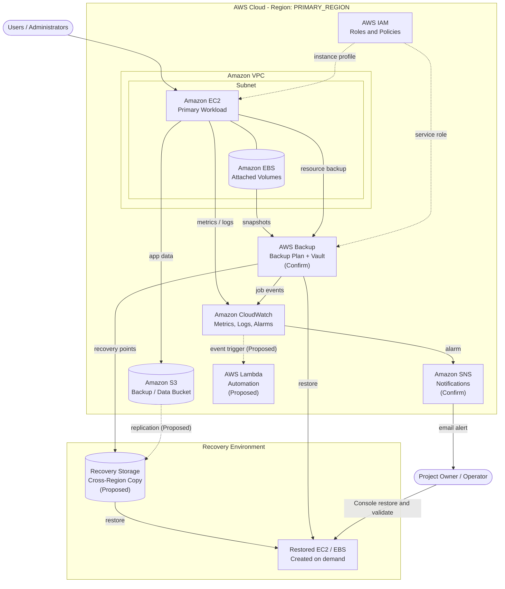

# AWS Architecture

This document describes the architecture of the **AWS Disaster Recovery & Backup Solution** by Prateek Hanvate. The environment was configured manually through the AWS Management Console.

> **Legend.** *Confirm* = the owner must verify that the component exists in the real environment. *Proposed* = a design suggestion that has **not** been implemented.

## 1. Architecture diagram

The same diagram is stored as [`architecture-diagram.mmd`](architecture-diagram.mmd).

## 2. Component roles

| Layer | Service | Role in the solution | Status |
|-------|---------|----------------------|--------|
| Compute | Amazon EC2 | Hosts the primary workload | Confirm |
| Block storage | Amazon EBS | Persistent volumes; source of snapshots | Confirm |
| Object storage | Amazon S3 | Stores data/backup objects; versioning and lifecycle target | Confirm |
| Backup | AWS Backup / EBS snapshots | Scheduled, policy-driven recovery points | Confirm |
| Identity | AWS IAM | Least-privilege roles for users, EC2 and backup service | Confirm |
| Network | Amazon VPC | Isolated network, subnets, security groups | Confirm |
| Monitoring | Amazon CloudWatch | Metrics, logs, alarms | Confirm |
| Notification | Amazon SNS | Alarm delivery (for example, email) | Confirm |
| Automation | AWS Lambda | Event-driven automation | Proposed |

## 3. Relationship between environments

- **Primary infrastructure:** EC2 + EBS inside a VPC in `<PRIMARY_REGION>`.
- **Backup storage:** EBS snapshots / AWS Backup vault and S3 buckets. Backups are stored separately from the workload so that loss of the instance does not remove the backup.
- **Monitoring:** CloudWatch observes the workload and backup jobs; SNS informs the operator.
- **Recovery infrastructure:** Created **on demand** from recovery points (a *backup and restore* DR strategy). No always-on standby is assumed. A cross-region copy is a *proposed* enhancement.

## 4. Data flows

1. **Production traffic:** Users reach the EC2 workload; data is written to EBS and/or S3.
2. **Backup flow:** A schedule triggers snapshot/backup jobs; recovery points are stored in a vault. See [`backup-flow.mmd`](backup-flow.mmd) and [`../Documentation/05-backup-strategy.md`](../Documentation/05-backup-strategy.md).
3. **Monitoring flow:** Metrics and job events reach CloudWatch; alarms notify via SNS.
4. **Recovery flow:** The operator restores to new resources and validates. See [`disaster-recovery-workflow.md`](disaster-recovery-workflow.md).

## 5. Design principles

- **Separation of backup from source** (different resource, ideally different account or region).
- **Least-privilege IAM.**
- **Encryption at rest and in transit.**
- **Tested recovery:** a backup is only trustworthy once a restore has been tested.
- **Cost awareness** through lifecycle and retention policies.
