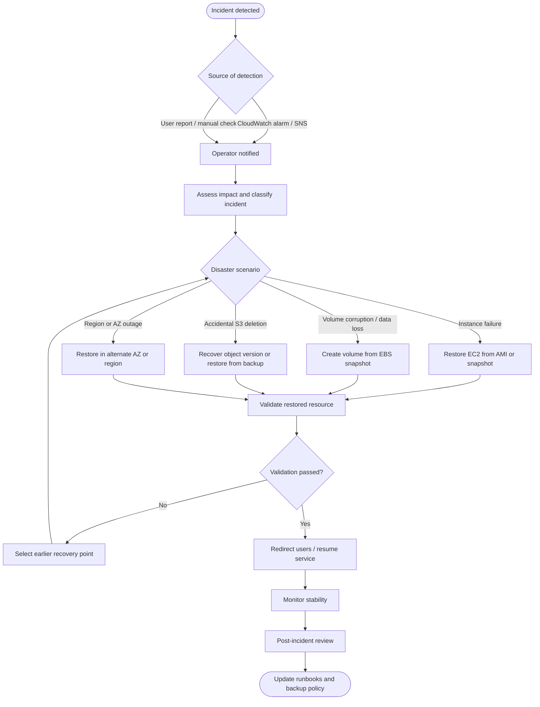

# Disaster Recovery Workflow

This workflow describes the generic *backup and restore* DR process for the project. Time targets are intentionally **not** stated; define them in [`../Configuration/recovery-configuration-template.md`](../Configuration/recovery-configuration-template.md) after measuring real restore tests.

## Phases

| Phase | Goal | Reference |
|-------|------|-----------|
| 1. Detect | Identify the incident quickly | [`../Documentation/09-testing-and-validation.md`](../Documentation/09-testing-and-validation.md) |
| 2. Assess | Determine scope, data-loss window and scenario | [`../Documentation/06-disaster-recovery-plan.md`](../Documentation/06-disaster-recovery-plan.md) |
| 3. Recover | Restore from the most suitable recovery point | [`../Documentation/07-recovery-procedures.md`](../Documentation/07-recovery-procedures.md) |
| 4. Validate | Confirm integrity and function | [`../Documentation/09-testing-and-validation.md`](../Documentation/09-testing-and-validation.md) |
| 5. Review | Capture lessons learned | [`../Documentation/06-disaster-recovery-plan.md`](../Documentation/06-disaster-recovery-plan.md) |
