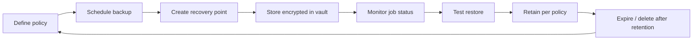

# 05 - Backup Strategy

## 1. Backup and restore lifecycle

1. **Define** what to protect, how often and for how long.
2. **Schedule** backups (AWS Backup rule or snapshot schedule).
3. **Create** recovery points (EBS snapshots, AMIs, S3 versions/copies).
4. **Store** them encrypted and separate from the source.
5. **Monitor** job success and failure.
6. **Test** restores regularly.
7. **Retain and expire** per policy to limit cost and risk.

## 2. Data protection principles

- **3-2-1 guideline:** three copies of data, on two different media/services, with one copy off-site (for example, another region or account). Mark which parts are implemented.
- **Encryption at rest** (EBS, S3, backup vault) and **in transit** (TLS).
- **Immutability / delete-protection** where available (for example, S3 Versioning with MFA Delete, AWS Backup Vault Lock) - *proposed unless implemented*.
- **Access control:** only the backup role and named administrators can delete recovery points.

## 3. Backup scope

| Resource | Method | Frequency | Retention | Status |
|----------|--------|-----------|-----------|--------|
| EC2 / EBS | AWS Backup or EBS snapshots / AMI | `<FREQUENCY>` | `<RETENTION>` | `<CONFIRM>` |
| S3 data | Versioning + lifecycle (and optional replication/backup) | continuous (versioning) | `<RETENTION>` | `<CONFIRM>` |
| Configuration records | Documentation in this repository (sanitised) | on change | version-controlled | Implemented (docs) |

## 4. Retention

Retention defines how long a recovery point is kept before deletion. Choose it based on:

- **Recovery needs** - how far back might you need to go (for example, to undo a corruption that is noticed late)?
- **Compliance** - legal or contractual obligations.
- **Cost** - longer retention means more stored data.

A common approach is tiered retention (for example, short-term frequent points and longer-term less frequent points). **Your values:** `<DAILY_RETENTION>`, `<WEEKLY_RETENTION>`, `<MONTHLY_RETENTION>`. See [`../Configuration/backup-policy-template.md`](../Configuration/backup-policy-template.md).

## 5. RPO and RTO

| Term | Definition | Driven by |
|------|-----------|-----------|
| **RPO - Recovery Point Objective** | The maximum acceptable amount of data loss, measured in time (for example, "we can lose up to *X* of data"). | Backup frequency |
| **RTO - Recovery Time Objective** | The maximum acceptable time to restore service after an incident. | Restore procedure, data size, automation, team readiness |

With scheduled backups, the worst-case data loss approximates the interval between recovery points. Restore time depends on data volume and the steps required.

> **This repository does not assert RPO/RTO values.** Record yours in [`../Configuration/recovery-configuration-template.md`](../Configuration/recovery-configuration-template.md): *target* values are business decisions; *achieved* values must come from real restore tests.

## 6. Backup verification

A backup that has never been restored is an unverified assumption. Verification includes:

- Confirming that backup jobs completed (`COMPLETED` state).
- Confirming that recovery points exist with expected age and size.
- Performing periodic restore tests ([`09-testing-and-validation.md`](09-testing-and-validation.md)).
- Example read-only check: [`../Scripts/verify-backup-example.sh`](../Scripts/verify-backup-example.sh).
