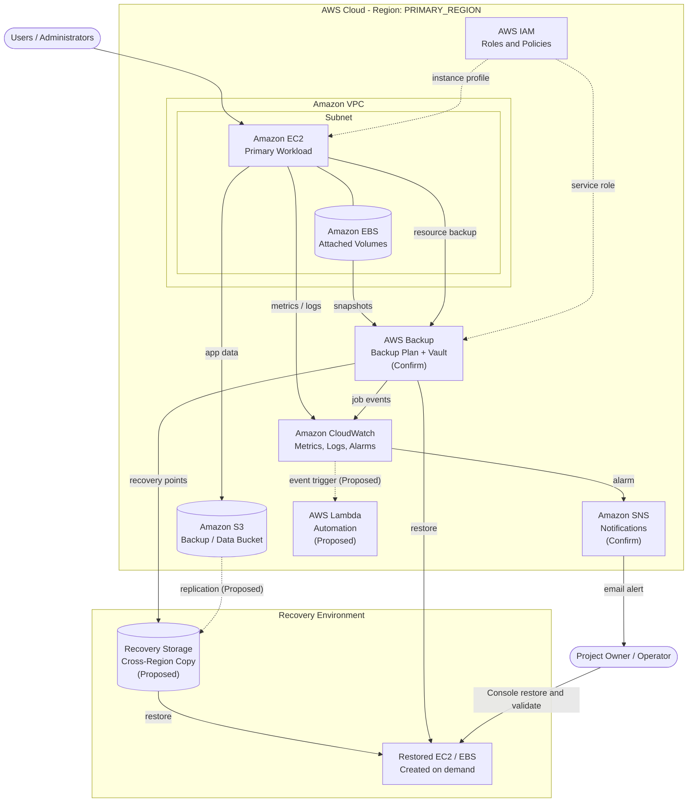
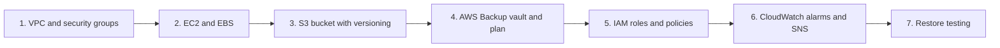
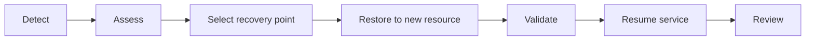

# AWS Disaster Recovery & Backup Solution


A documented backup and disaster recovery solution on Amazon Web Services, designed and configured manually through the **AWS Management Console**, with reusable templates, runbooks and safe example scripts.

> **Transparency note.** The infrastructure was built manually in the AWS Console. It was **not** provisioned with Terraform, CloudFormation or any other Infrastructure as Code. Scripts in this repository are illustrative examples and were **not** used in the original project. Items marked *Confirm* or *Proposed* are not claimed as implemented. No RTO/RPO values, test results or screenshots are fabricated.

## Introduction

Organisations depend on cloud workloads that must survive instance failure, data corruption, human error and outages. This project applies AWS services to protect a workload with scheduled backups, defines how to recover from common disaster scenarios, and documents monitoring, security and cost practices following a *backup and restore* DR strategy.

## Objectives

1. Protect EC2/EBS and S3 data with regular, retrievable backups.
2. Define retention and lifecycle policies.
3. Document restoration procedures for common disaster scenarios.
4. Monitor health and be alerted to failures.
5. Apply IAM least privilege and encryption.
6. Control cost through lifecycle management.
7. Validate recovery through restore testing.

## Problem statement

Without tested backups and a clear recovery plan, failures can cause prolonged downtime and permanent data loss. See [`Documentation/02-problem-statement.md`](Documentation/02-problem-statement.md).

## Technology stack

| Area | Technology |
|------|------------|
| Cloud platform | Amazon Web Services |
| Provisioning method | AWS Management Console (manual) |
| Documentation | Markdown, Mermaid diagrams |
| Example automation | Bash, AWS CLI v2 |
| Repository quality | GitHub Actions, markdownlint, ShellCheck, Mermaid CLI, Gitleaks |

## AWS services

| Service | Role | Status |
|---------|------|--------|
| Amazon EC2 | Primary workload | Confirm |
| Amazon EBS | Block storage and snapshots | Confirm |
| Amazon S3 | Data/backup object storage | Confirm |
| AWS Backup | Policy-based backup and vaults | Confirm |
| AWS IAM | Access control | Confirm |
| Amazon VPC | Network isolation | Confirm |
| Amazon CloudWatch | Metrics, logs, alarms | Confirm |
| Amazon SNS | Alert notifications | Confirm |
| AWS Lambda | Automation | Proposed |

Details: [`Documentation/03-aws-services.md`](Documentation/03-aws-services.md).

## Architecture



More: [`Architecture/aws-architecture.md`](Architecture/aws-architecture.md) | [`Architecture/disaster-recovery-workflow.md`](Architecture/disaster-recovery-workflow.md)

## Implementation workflow



Step-by-step console setup: [`Documentation/04-infrastructure-setup.md`](Documentation/04-infrastructure-setup.md).

## Backup strategy

- Scheduled recovery points for EC2/EBS through AWS Backup or snapshots.
- S3 versioning and lifecycle rules.
- Encryption at rest, retention per policy (`<RETENTION>` - to be defined by the owner).
- RPO and RTO explained in [`Documentation/05-backup-strategy.md`](Documentation/05-backup-strategy.md); target and measured values are recorded in [`Configuration/recovery-configuration-template.md`](Configuration/recovery-configuration-template.md).

## Disaster recovery process



Scenarios covered: EC2 failure, EBS loss, S3 deletion, AZ/Region outage, security incident. See [`Documentation/06-disaster-recovery-plan.md`](Documentation/06-disaster-recovery-plan.md) and [`Documentation/07-recovery-procedures.md`](Documentation/07-recovery-procedures.md).

## Screenshots

Real, redacted console screenshots belong in [`Screenshots/`](Screenshots/README.md) (EC2, S3, EBS, Backup, CloudWatch, Recovery).

| Area | Status |
|------|--------|
| EC2 | `<ADD YOUR SCREENSHOT>` |
| S3 | `<ADD YOUR SCREENSHOT>` |
| EBS | `<ADD YOUR SCREENSHOT>` |
| AWS Backup | `<ADD YOUR SCREENSHOT>` |
| CloudWatch | `<ADD YOUR SCREENSHOT>` |
| Recovery | `<ADD YOUR SCREENSHOT>` |

## Testing results

No results are claimed until you record them. Use the log in [`Documentation/09-testing-and-validation.md`](Documentation/09-testing-and-validation.md).

| Test | Date | Measured result |
|------|------|-----------------|
| EC2/EBS restore | `<DATE>` | `<MEASURED>` |
| S3 version recovery | `<DATE>` | `<MEASURED>` |
| Alert delivery | `<DATE>` | `<MEASURED>` |

## Security considerations

IAM least privilege and MFA, encryption, Block Public Access, restricted security groups, CloudTrail, and a strict `.gitignore`. Read the [security guide and pre-publish checklist](Documentation/08-security-best-practices.md).

## Limitations

Manual configuration, backup-and-restore recovery time, possible single-region exposure, and manual restore steps. See [`Documentation/11-limitations-and-future-scope.md`](Documentation/11-limitations-and-future-scope.md).

## Future enhancements (proposed, not implemented)

- Cross-region / cross-account backup copies
- Infrastructure as Code (Terraform or CloudFormation)
- Automated restore testing
- Vault Lock / S3 Object Lock
- Pilot Light or Warm Standby, Route 53 failover

## Repository structure

```text
AWS-Disaster-Recovery-Solution/
├── README.md
├── LICENSE
├── .gitignore
├── CONTRIBUTING.md
├── CHANGELOG.md
├── Architecture/        # diagrams (.mmd) and architecture/workflow docs
├── Documentation/       # 01-11 technical documentation
├── Configuration/       # inventory, backup policy, recovery and environment templates
├── Scripts/             # safe example scripts (not used in the original project)
├── Screenshots/         # EC2, S3, EBS, Backup, CloudWatch, Recovery
├── GitHub/              # upload guide and Actions notes
└── .github/workflows/   # optional quality-check workflow
```

## Quality checks

An optional GitHub Actions workflow validates Markdown, Mermaid diagrams, shell syntax and secret exposure. It never touches AWS. See [`GitHub/GITHUB_ACTIONS_EXAMPLE.md`](GitHub/GITHUB_ACTIONS_EXAMPLE.md).

## Author

**Prateek Hanvate**
- GitHub: `<YOUR_GITHUB_PROFILE_URL>`
- LinkedIn: `<YOUR_LINKEDIN_URL>`
- Email: `<OPTIONAL_PUBLIC_EMAIL>`

## License

Released under the [MIT License](LICENSE).
# AWS-backup-and-recovery-and-DR-solution

