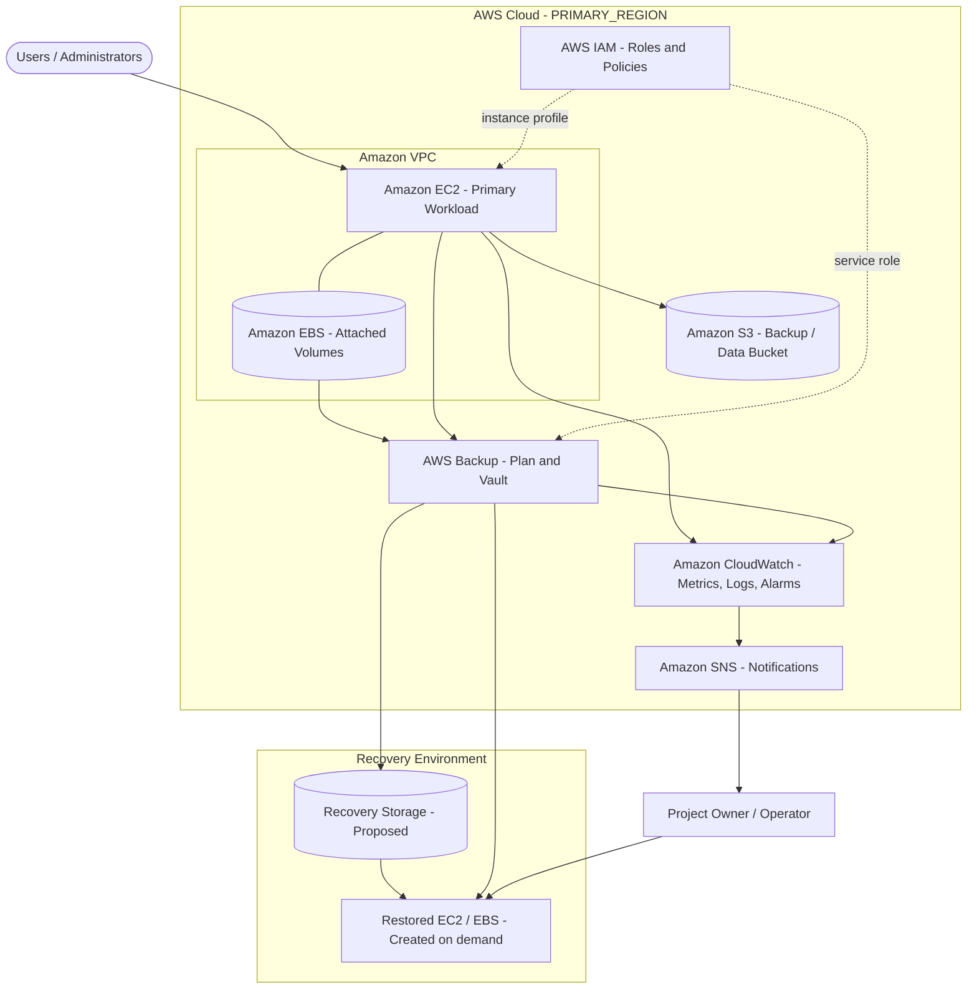

# AWS Disaster Recovery & Backup Solution


A documented backup and disaster recovery solution on Amazon Web Services, configured manually through the **AWS Management Console**, with reusable templates, runbooks and safe example scripts.

> **Transparency note:** The infrastructure was built manually in the AWS Console. It was **not** provisioned with Terraform, CloudFormation or other Infrastructure as Code. Scripts in this repository are examples and were not used to build the infrastructure.

## Introduction

This project documents ways to protect an AWS workload against instance failure, data corruption, human error and outages with backups, recovery procedures, monitoring and security controls.

## Objectives

1. Protect EC2/EBS and S3 data with regular, retrievable backups.
2. Define retention and lifecycle policies.
3. Document restoration procedures for common disaster scenarios.
4. Monitor health and be alerted to failures.
5. Apply IAM least privilege and encryption.
6. Control cost through lifecycle management.
7. Validate recovery through restore testing.

## Technology stack

| Area | Technology |
|------|------------|
| Cloud platform | Amazon Web Services |
| Provisioning method | AWS Management Console (manual) |
| Documentation | Markdown, Mermaid diagrams |
| Example automation | Bash, AWS CLI v2 |
| Repository quality | GitHub Actions, markdownlint, ShellCheck, Mermaid CLI, Gitleaks |

## AWS services

| Service | Role | Status |
|---------|------|--------|
| Amazon EC2 | Primary workload | Confirm |
| Amazon EBS | Block storage and snapshots | Confirm |
| Amazon S3 | Data/backup object storage | Confirm |
| AWS Backup | Policy-based backup and vaults | Confirm |
| AWS IAM | Access control | Confirm |
| Amazon VPC | Network isolation | Confirm |
| Amazon CloudWatch | Metrics, logs, alarms | Confirm |
| Amazon SNS | Alert notifications | Confirm |
| AWS Lambda | Automation | Proposed |

See [`Documentation/03-aws-services.md`](Documentation/03-aws-services.md) for details.

## Architecture



More diagrams: [`Architecture/aws-architecture.md`](Architecture/aws-architecture.md) and [`Architecture/disaster-recovery-workflow.md`](Architecture/disaster-recovery-workflow.md).

## Backup and recovery

- Schedule EC2/EBS recovery points through AWS Backup or snapshots.
- Use S3 versioning and lifecycle rules.
- Apply encryption at rest and define retention according to owner policy.
- Document RPO and RTO targets and measured values in the recovery configuration template.
- Restore to a new resource, validate it, and record the results before resuming service.

See [`Documentation/05-backup-strategy.md`](Documentation/05-backup-strategy.md) and [`Documentation/06-disaster-recovery-plan.md`](Documentation/06-disaster-recovery-plan.md).

## Screenshots and testing

Add only real, redacted AWS console screenshots to [`Screenshots/`](Screenshots/README.md). Do not claim test results until they have been measured and recorded in [`Documentation/09-testing-and-validation.md`](Documentation/09-testing-and-validation.md).

## Security and limitations

Use IAM least privilege and MFA, encryption, S3 Block Public Access, restricted security groups, CloudTrail and the strict `.gitignore`. This repository documents a manually configured solution; recovery and cross-region capabilities may require manual steps and further configuration. See the [security guide](Documentation/08-security-best-practices.md) and [limitations](Documentation/11-limitations-and-future-scope.md).

## Repository structure

```text
Architecture/        # diagrams and architecture/workflow docs
Configuration/       # inventory, backup policy, recovery and environment templates
Documentation/       # technical documentation
GitHub/              # upload guide and Actions notes
Screenshots/         # redacted console screenshots
Scripts/             # safe example scripts
.github/workflows/   # quality-check workflow
```

## Quality checks

The optional GitHub Actions workflow validates Markdown, Mermaid diagrams, shell syntax and secret exposure. It does not access AWS. See [`GitHub/GITHUB_ACTIONS_EXAMPLE.md`](GitHub/GITHUB_ACTIONS_EXAMPLE.md).

## Author

**Prateek Hanvate**

- GitHub: `<YOUR_GITHUB_PROFILE_URL>`
- LinkedIn: `<YOUR_LINKEDIN_URL>`
- Email: `<OPTIONAL_PUBLIC_EMAIL>`

## License

Released under the [MIT License](LICENSE).
